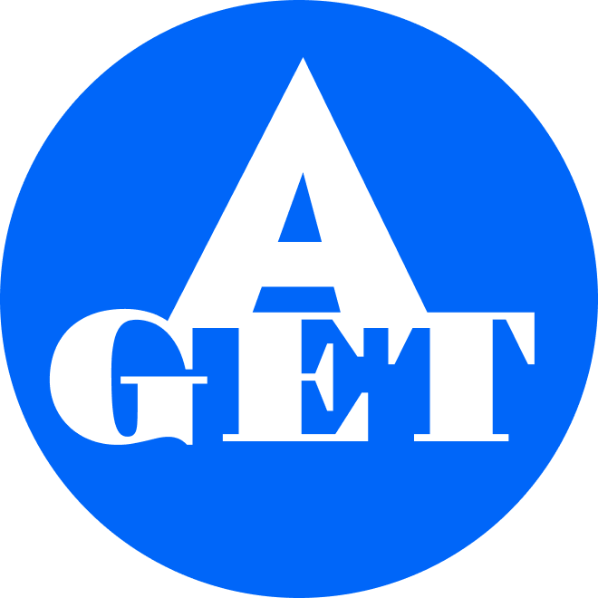

  
  
  
  
  
  

# Sobre el proyecto

AulaGet es una herramienta que se conecta a tu plataforma Moodle [aula.usm.cl](https://aula.usm.cl) usando tu cookie de sesión. Muestra tus cursos y su contenido en una interfaz gráfica clara, facilitando la navegación y descarga de archivos.

# Instalación

## Modo de Uso
 
### Obtén tu cookie `MoodleSession`
 
1. Inicia sesión en [aula.usm.cl](https://aula.usm.cl) desde tu navegador.
2. Abre la consola de navegador con `Ctrl + Shift + J`
3. Escribe `document.cookie` y presiona `Enter`
4. Copia el valor de la cookie llamada **`MoodleSession`**.

> [!WARNING]
> Esta cookie equivale a tu sesión iniciada. *No la compartas*

